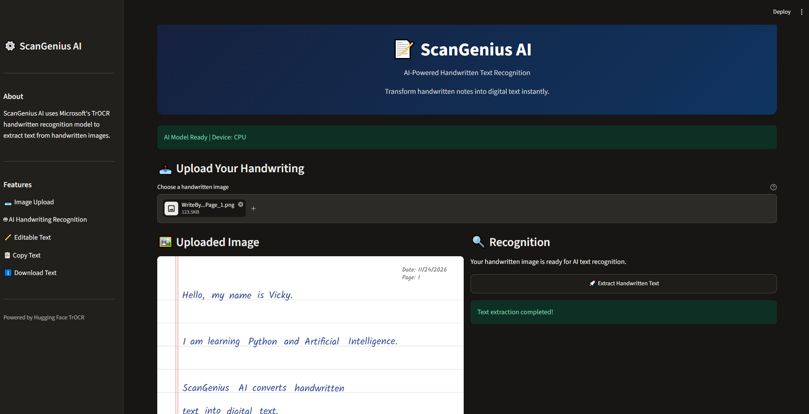
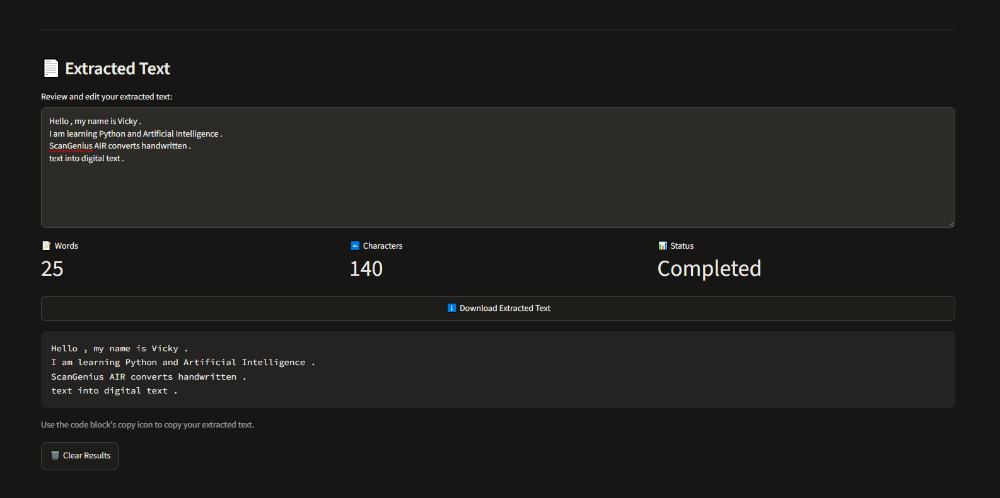

# 📝 ScanGenius AI

### AI-Powered Handwritten Text Recognition

ScanGenius AI is an AI-powered handwritten text recognition application that converts handwritten notes into editable digital text using Microsoft's TrOCR model.

## ✨ Features

- 📤 Upload handwritten images (PNG, JPG, JPEG)
- 🤖 AI-powered handwriting recognition
- 🔍 Image preprocessing using OpenCV
- 📝 Handwritten line detection and extraction
- ✏️ Edit recognized text directly
- 📊 Word and character statistics
- ⬇️ Download extracted text
- 🎨 Interactive Streamlit interface

## 🛠️ Technologies Used

- Python
- Streamlit
- PyTorch
- Hugging Face Transformers
- Microsoft TrOCR
- OpenCV
- NumPy
- Pillow (PIL)

## 🧠 How It Works

1. Upload a handwritten image.
2. Preprocess the image and isolate handwriting.
3. Detect individual handwritten text regions using OpenCV.
4. Pass detected regions to Microsoft's TrOCR model.
5. Convert handwriting into digital text.
6. Review, edit and download the extracted result.

## 📂 Project Structure

```text
ScanGenius-AI/
│
├── app.py
├── utils/
│   ├── __init__.py
│   └── ocr_engine.py
│
├── assets/
│   └── scangenius-dashboard.png
│
├── requirements.txt
├── README.md
└── .gitignore
```

## ⚙️ Installation

### 1. Clone the repository

```bash
git clone https://github.com/21vicky/ScanGenius-AI.git
cd ScanGenius-AI
```

### 2. Create a virtual environment

```bash
python -m venv venv
```

### 3. Activate the environment

Windows PowerShell:

```powershell
.\venv\Scripts\Activate.ps1
```

### 4. Install dependencies

```bash
pip install -r requirements.txt
```

### 5. Run the application

```bash
streamlit run app.py
```

The TrOCR model will be downloaded automatically on its first run if it is not already cached.

## 📸 Screenshots

## 📸 Screenshots

### Application Dashboard


### OCR Recognition Results


## 🎯 Project Goal

To explore practical applications of AI and computer vision by building a handwritten text recognition system using pretrained deep learning models.

## 🔮 Future Improvements

- Support for different handwriting colours.
- Improved recognition accuracy.
- Better full-page text segmentation.
- Multi-page document recognition.
- PDF upload and text extraction.

## 👨‍💻 Author

**Vignesh U**

Full Stack Developer | Python | AI & Data Analytics

GitHub: [21vicky](https://github.com/21vicky)

---

*Built with ❤️ using Python, Streamlit and Hugging Face Transformers.*